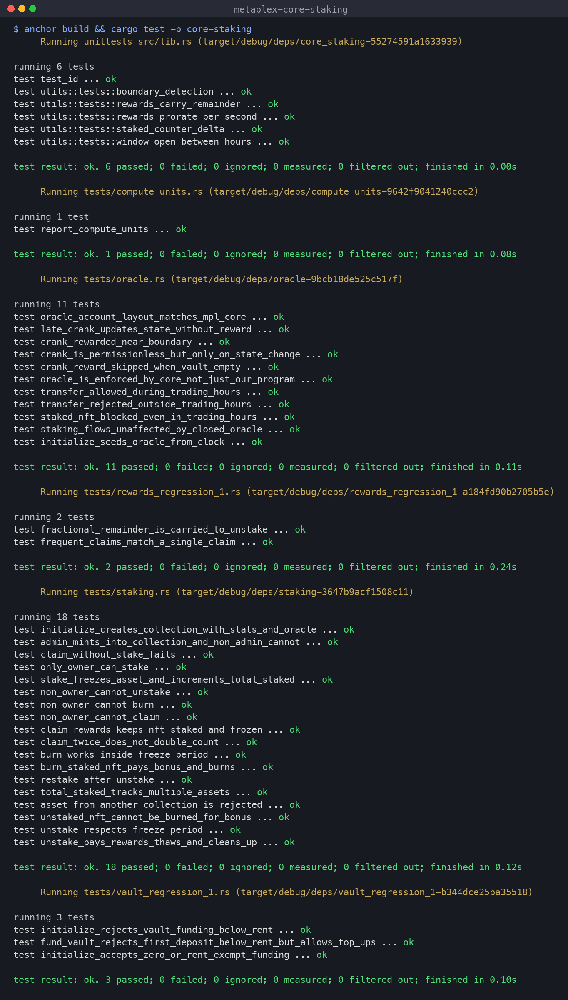

# Metaplex Core NFT Staking

Week 5 assignment (Metaplex): an Anchor program that stakes [MPL Core](https://developers.metaplex.com/core) NFTs **without moving them out of the owner's wallet**. It covers all of Task 1 and the optional Task 2:

| Requirement | Instruction | How |
|---|---|---|
| **1.1** Claim rewards without unstaking | `claim_rewards` | Mints accrued SPL rewards to the owner's ATA. The asset stays staked and frozen. |
| **1.2** Burn-to-earn with BurnDelegate | `burn_staked_nft` | Config PDA (the BurnDelegate set at stake) burns the asset and mints pending rewards + a large `burn_bonus`. |
| **1.3** Collection-level stats | `stake` / `unstake` / `burn_staked_nft` | `"total_staked"` Attribute on the **Collection**: +1 on stake, −1 on unstake and burn. |
| **2** Oracle: time-based transfer | `update_oracle`, `transfer_nft` | Oracle adapter on the Collection (Transfer only, `CanReject`) reads a PDA that a permissionless, rewarded crank flips between `Pass` (09:00–17:00 UTC) and `Rejected`. |

All 41 tests run locally against the **real MPL Core program** in LiteSVM, and the clock moves forward to test rewards, freeze periods and trading hours. No wallet, RPC or devnet is needed.



## Instructions

| Instruction | Signer | What it does |
|---|---|---|
| `initialize(args)` | admin + collection keypair | Creates the Core Collection (update authority = config PDA) with `Attributes{total_staked:"0"}` and the Oracle adapter. Also creates the config, reward mint, and oracle PDA (seeded from the current time), and funds the crank vault. |
| `fund_vault(amount)` | anyone | Tops up the lamport vault that pays crankers. |
| `mint_nft(name, uri)` | admin | Mints a Core asset into the collection for any owner. |
| `stake` | owner | Adds `FreezeDelegate{frozen:true}` + `BurnDelegate` (authority = config PDA), opens a `StakeRecord`, and does `total_staked += 1`. |
| `claim_rewards` | owner | Mints `elapsed × rewards_per_day / 86400` (the sub-unit remainder carries over to the next claim) and resets `last_claimed_at`. The NFT stays frozen. |
| `unstake` | owner | Only after `freeze_period`. Pays pending rewards, thaws, removes both plugins, does `total_staked -= 1`, and closes the record. |
| `burn_staked_nft` | owner | Pays pending + `burn_bonus`, thaws, burns via BurnDelegate, does `total_staked -= 1`, and closes the record. |
| `update_oracle` | anyone | Sets Transfer to `Pass` in hours and `Rejected` outside them. It fails if nothing changes. It pays `crank_reward` from the vault when called within `crank_window` of 09:00 or 17:00. |
| `transfer_nft` | owner | Calls Core `TransferV1` with the oracle PDA as a remaining account, so the Oracle plugin decides. |

PDAs, the plugin matrix, flow diagrams, design decisions and error codes are in **[docs/architecture.md](docs/architecture.md)**.

## Project layout

```
idl/core_staking.json            # generated Anchor IDL
programs/core-staking/
├── src/
│   ├── lib.rs                  # #[program] entrypoints
│   ├── constants.rs            # seeds, decimals, CAN_REJECT flag
│   ├── error.rs
│   ├── utils.rs                # reward math, trading-hour logic, Core CPI helpers (+ unit tests)
│   ├── state/                  # Config, StakeRecord, Oracle (mirrors mpl_core OracleValidation)
│   └── instructions/           # one file per instruction
└── tests/
    ├── common/mod.rs           # LiteSVM harness: loads both programs, ix builders, clock warp
    ├── staking.rs              # Task 1 (18 tests)
    ├── oracle.rs               # Task 2 (11 tests)
    ├── rewards_regression_1.rs # QA ISSUE-001: reward remainder carry
    ├── vault_regression_1.rs   # QA ISSUE-002: vault rent-exempt guard
    ├── compute_units.rs        # CU report
    └── fixtures/mpl_core.so    # real MPL Core program binary
```

## Build and test

Requirements: Rust (tested with 1.96), Solana CLI 3.x, Anchor CLI 1.1.2.

```bash
anchor build                                  # → target/deploy/core_staking.so + target/idl/core_staking.json
cargo test -p core-staking                    # unit + integration tests (needs the .so from anchor build)
cargo test -p core-staking --test compute_units -- --nocapture   # CU table
```

The full output is in [docs/test-results.txt](docs/test-results.txt).

### What the tests prove

**Task 1 (`tests/staking.rs`)**
- After stake, the asset stays in the owner's wallet with `FreezeDelegate{frozen}` and `BurnDelegate`, both owned by the config PDA. `total_staked` is 1, and staking twice fails.
- `claim_rewards` after 1 day pays exactly `rewards_per_day`, and the asset is **still frozen**. An immediate re-claim fails with `NothingToClaim`. Two half-day claims add up to one day.
- `unstake` fails before the freeze period. After it, rewards from claims plus the unstake payout equal the full period. The plugins are removed, the record is closed, and the NFT can be transferred again and restaked.
- `burn_staked_nft` pays pending + bonus. The asset is burned (Core leaves a `Key::Uninitialized` tombstone), and `total_staked` and the collection's `current_size` both drop.
- `total_staked` stays correct across several stakers, unstakes and burns.
- Auth: non-owners can't stake, claim, unstake or burn (`NotOwner` / `ConstraintHasOne`). Non-admins can't mint. Assets from another collection fail with `WrongCollection`.

**Task 2 (`tests/oracle.rs`)**
- The oracle bytes deserialize with the **real `mpl_core::types::OracleValidation`** at offset 8.
- Transfers at 10:00 succeed. After the 17:00 crank they are rejected by MPL Core, and they work again after the 09:00 crank the next day.
- A **direct MPL Core `TransferV1`** that skips this program is also rejected at night, which shows the Collection plugin is what enforces the rule.
- The crank is permissionless. It fails with `OracleAlreadyUpToDate` when nothing changes, so it can't be farmed.
- A crank at 17:02 or 09:00 receives `crank_reward`. A late crank at 21:00 fixes the state but isn't paid. An underfunded vault skips the payout and never drops below rent, and `fund_vault` refills it.
- Staked NFTs can't be transferred even during trading hours, and stake, claim, unstake and burn all work while transfers are closed.

**QA regressions**
- `rewards_regression_1.rs`: 100 one-second claims pay exactly what one 100-second claim pays, and the leftover remainder is still paid on unstake.
- `vault_regression_1.rs`: a vault deposit that would leave the vault below the rent-exempt minimum fails with `VaultBelowRentExempt`. Top-ups of an already funded vault still work.

### QA

A `/qa` pass probed for ways to escape staking by calling MPL Core directly, plus rent and rounding edge cases. It fixed 2 medium issues and deferred 1 low one. The full report is in [docs/qa-report.md](docs/qa-report.md).

### Compute units

| Instruction | Compute units |
|---|---|
| `mint_nft` | 22,179 |
| `stake` | 61,891 |
| `claim_rewards` (creates ATA) | 46,553 |
| `unstake` | 85,271 |
| `burn_staked_nft` | 66,999 |
| `update_oracle` (paid crank) | 11,148 |
| `transfer_nft` (oracle check) | 18,627 |

All are well under the 200k default.

## Test configuration

| Param | Value |
|---|---|
| `rewards_per_day` | 100 tokens (6 decimals) |
| `freeze_period` | 3 days |
| `burn_bonus` | 1,000 tokens |
| trading hours | 09:00–17:00 UTC |
| `crank_reward` / `crank_window` | 0.01 SOL / ±5 min |

## Notes

- `anchor build` prints three "Stack offset exceeded" messages for `mpl_core::hooked::{Asset,Collection}::deserialize` and `registry_records_to_plugin_list`. These are full-account deserializers inside the mpl-core crate. The program never calls them on-chain: it uses `BaseAssetV1::from_bytes` and `fetch_plugin`. Other Anchor programs that depend on mpl-core print the same warning.
- `mpl-core` is used **without** its `anchor` feature. Its `*CpiBuilder`s use the same solana 3.x `AccountInfo` as Anchor 1.x, so the program needs no wrapper types.
- Program ID: `ATwkeErS3hJ6rfHNN4ZZax6UtWExuYTE2TcJdkMvnfnt`

## License

MIT
